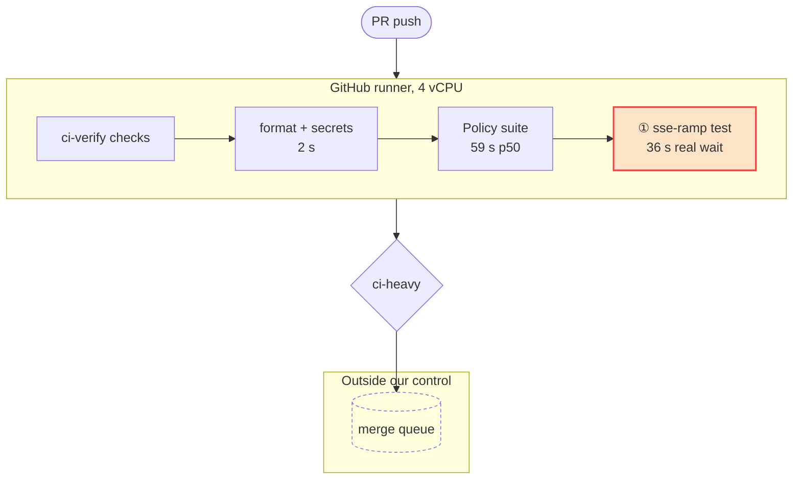
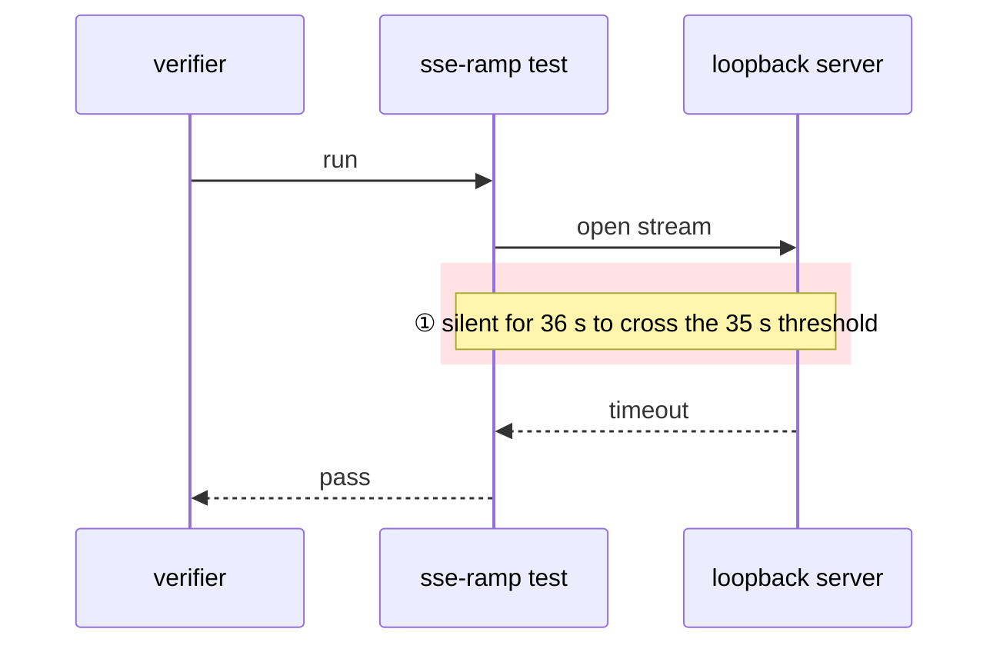
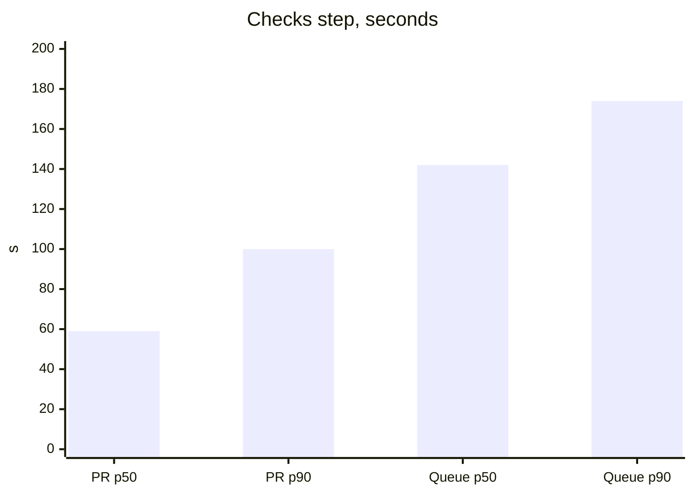
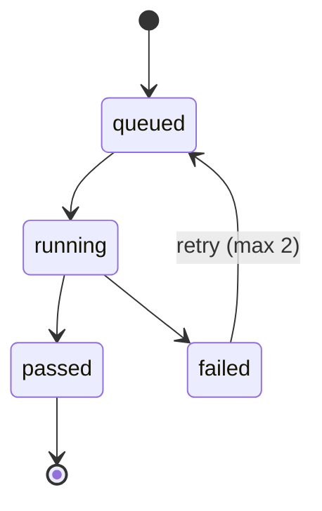
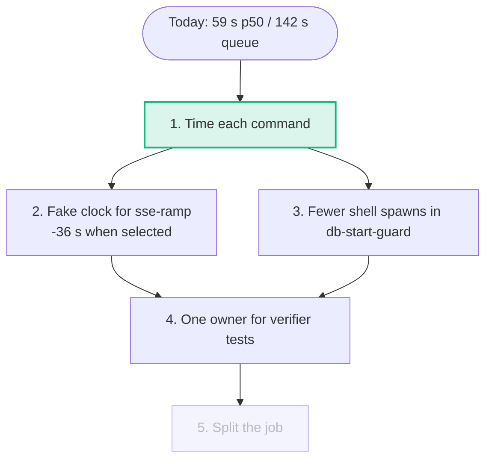
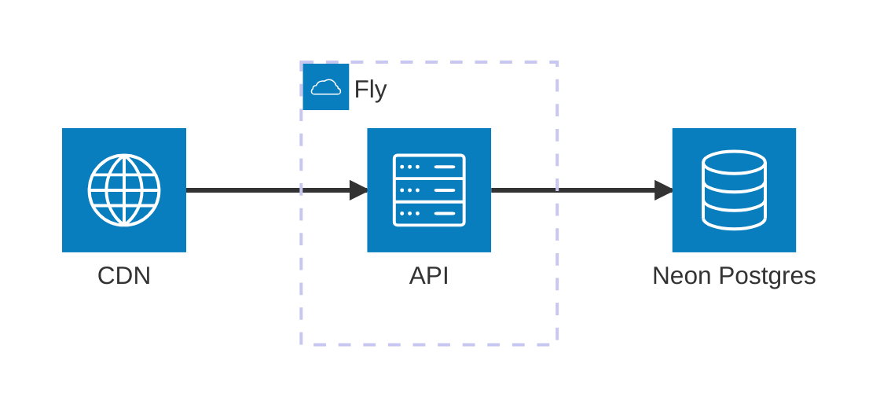

## Colour classes

%% text-only: a code block of classes, no diagram to draw %%

These classes work on both light and dark themes because the fills are translucent, so the theme shows through and text keeps the theme's colour. Paste only the ones a diagram uses. Mermaid's `classDef` can't read CSS variables, and `var(...)` is a parse error.

```text
classDef bad  fill:#ef444426,stroke:#ef4444,stroke-width:2px
classDef good fill:#10b98126,stroke:#10b981,stroke-width:2px
classDef warn fill:#f59e0b26,stroke:#f59e0b,stroke-width:2px
classDef ext  fill:transparent,stroke-dasharray:4 3
classDef dim  opacity:0.55
```

To colour an edge, use `linkStyle <index> stroke:#ef4444,stroke-width:2px`. Edges are numbered from 0 in the order they're written.

In vault-report HTML, use Tailwind palette hex values (`#ef4444` red-500, `#10b981` emerald-500, `#f59e0b` amber-500, `#0ea5e9` sky-500). The exporter maps them onto the theme.

## Boundaries and a flaw

One subgraph per boundary. The flaw sits on the node where it happens, with a marker the prose repeats.

A subgraph's `direction` is ignored when an outside edge touches a node inside it. To lay a boundary out sideways inside a vertical diagram, link to the subgraph id (`dev --> gh`), not to its first node.



## Who waits on whom

Use `rect` to shade the wait, and a note to put the number on it.



## One run as a timeline

`gantt` with `dateFormat X` takes seconds, which suits a single CI run or request. A gantt fills the full width of its container and its text shrinks with it. In vault-report, start the block with `%%{init: {"gantt": {"useWidth": 760, "barHeight": 26, "fontSize": 14}}}%%`.

```mermaid
gantt
  dateFormat X
  axisFormat %M:%S
  section Policy (job A)
  db-start-guard       :crit, 0, 59
  verify tests         :59, 74
  environment-contracts:74, 90
  everything else      :90, 136
```



## Numbers across groups



## A lifecycle



## A plan

Each step names what it unblocks. Green is the first safe patch. Grey is the step to do only if the numbers still call for it.



## Infrastructure


