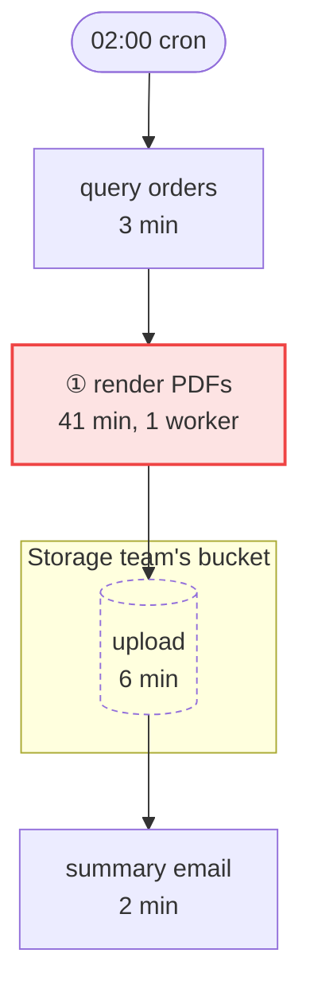
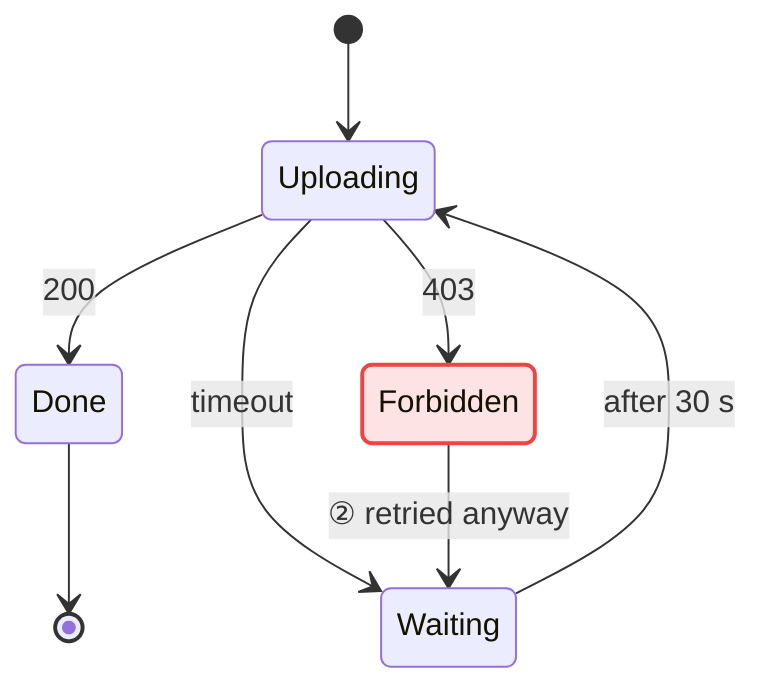
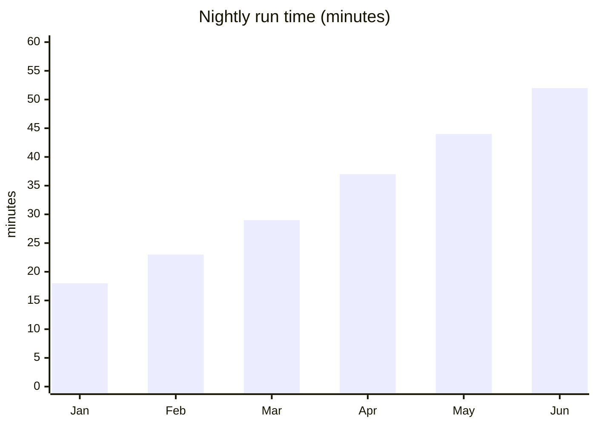
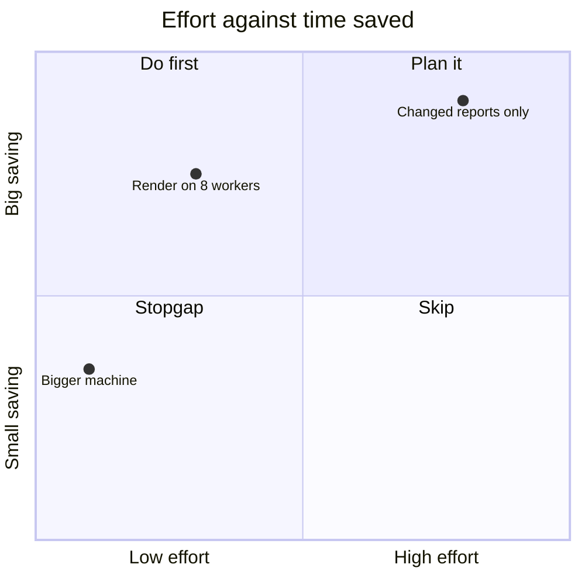

Each section below takes one part of a prose-heavy note about a made-up nightly export job and redraws it. The before is how a first draft tends to read. The after follows SKILL.md, and each pair uses a different kind of picture.

## A pipeline with a flaw

Before:

> Every night at 02:00 the scheduler starts the export job. The job first queries the orders database, which takes about 3 minutes, then renders each customer's report as a PDF. Rendering runs on a single worker and takes around 41 minutes, which is most of the 52-minute run. After that, the job uploads the PDFs to a storage bucket that belongs to another team, which takes about 6 minutes, and finally sends a summary email.

After:

① Rendering is 41 of the 52 minutes because one worker renders every report in turn.

The order, the owner of each step, and every number moved onto the diagram. The prose keeps only the cause.

## A table with prose in its cells

Before:

| Step | Notes |
| --- | --- |
| query | Runs against the read replica so it doesn't load the primary, though the replica can lag at busy times. |
| render | Single-threaded because the PDF library wasn't thread-safe in the version we pinned two years ago. |
| upload | Retries on any error, including permission errors that never succeed, so a bad credential spins until timeout. |

After:

| Step | Time | Runs on | Owner | Status |
| --- | --- | --- | --- | --- |
| query | 3 min | read replica | us | ok |
| render | 41 min | 1 worker | us | ① slow |
| upload | 6 min | storage bucket | storage team | ② retries on 403 |
| email | 2 min | mail API | us | ok |

> [!WARNING]
> Render is single-threaded only because of an old pinned version of the PDF library. The current version is thread-safe.

Each cell holds one value, so the reader can scan a column. The one reason worth keeping moved into a callout.

## A retry loop

Before:

> When an upload fails, the job waits 30 seconds and tries again, whatever the error. Timeouts usually clear on the second try. A 403 from the bucket means the credential is wrong, and that never clears, so the job keeps retrying until the six-hour job timeout kills it.

After:

② A 403 never clears, so the loop runs until the six-hour timeout. Forbidden should end the run.

## Numbers over time

Before:

> Run time has grown every month this year: 18 minutes in January, 23 in February, 29 in March, 37 in April, 44 in May, and 52 in June. Customer count roughly tripled over the same months, and render time grows with it.

After:

Customers tripled over the same months, and render time grows with them.

## Choosing a fix

Before:

> We could render in parallel, which is about two days of work and should bring the run down to around 16 minutes. We could also move to a bigger machine, which takes an hour but costs about $300 a month more and only gets the run to about 32 minutes. A third option is to render only the reports that changed, which saves the most time but needs a week and a change-tracking table.

After:

| Option | Effort | Run time | Extra cost |
| --- | --- | --- | --- |
| Render on 8 workers | 2 days | ~16 min | none |
| Bigger machine | 1 hour | ~32 min | $300/month |
| Render changed reports only | 1 week | ~8 min | new table |

Rendering on 8 workers is the first step, and rendering only changed reports can follow once the change-tracking table exists.

## What each rewrite does

- Numbers sit on the picture (`41 min, 1 worker`), so the prose doesn't have to carry them.
- A numbered marker (① ②) ties the diagram, the table, and the prose to one flaw, so the reader can follow it through the note.
- Table cells hold values. Reasons move into prose or a callout.
- Each picture fits the content: a flowchart for steps, a state diagram for retries, bars for change over time, and a table plus a quadrant for options.
