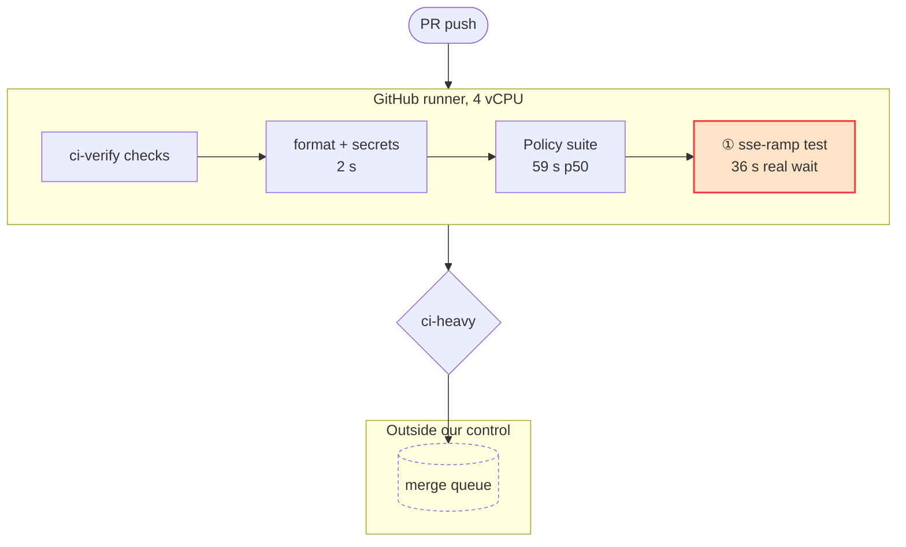

## Before and after: a CI audit

%% text-only: describes a rewrite; the diagrams it names are in references/diagrams.md %%

The note answered "why does the Policy check take so long?" The first version was 2,000 words of prose and wide tables, with no diagrams. Nine table cells ran past 20 words, and the reader had to rebuild the pipeline in their head from paragraphs. The rewrite is a single vault-report note. It has 740 visible words, four diagrams, and its methodology folded away.

Each section of the old note, and what replaced it:

1. **Lead.** Two bold sentences and a paragraph of percentiles became the same lead plus three stat cards: PR 59 / 100 s, queue 142 / 174 s, and four groups at 82%.
2. **What runs.** 224 words and a table of layers became an overview flowchart. The runner is a subgraph with the Policy step inside it. The two slow tests are red, marked ① and ②, and the work that runs twice is amber, marked ③.
3. **Path filters.** A paragraph on queue mode and docs-only skips became a `flowchart TB` from run type to what runs. The queue's "all 36 commands" is red, and two amber cards name the wasted work.
4. **Where the time goes.** 420 words and a six-column table with prose in its cells became a `gantt` of one real run, where the two red bars fill half the chart. Below it are a three-row lane table and four short cards keyed ① to ③. Sample sizes and log links sit in a collapsed "How this was measured".
5. **Proposals.** Five proposals in 529 words became a plan flowchart. Step 1 is green, steps 2 to 4 carry the markers of the flaws they fix, and the split is grey. Five items of about 30 words each follow.
6. **Cost.** A paragraph with the formula inline became one sentence with the $0.42 figure, six cohort chips, and the formula in a collapsed block.

## One section, before and after

The "What runs" section, abridged. Before, the reader rebuilds the pipeline from sentences:

> The Policy check runs inside the `ci-verify` job on a GitHub-hosted runner with 4 vCPU. `ci-verify` first runs the cheap checks, format and secrets scanning, which together take about 2 seconds. It then runs the Policy suite, which takes 59 s at p50 and is most of the job. Most of that time isn't CPU work. The `sse-ramp` test waits on a loopback server and spends about 36 seconds of real time sleeping through its ramp. Once `ci-verify` passes, `ci-heavy` runs, and only then does the PR reach the merge queue, which sits outside our control.

After, the diagram carries the order, the boundaries and the numbers, and the prose keeps only the cause:

> ① `sse-ramp` waits on a loopback server for 36 of the suite's 59 s. The time is spent waiting, so a faster runner won't help.

The rewrite moves every number onto a node, puts the runner and the queue in their own boundaries, and marks the flaw where it happens. The prose shrinks to the one thing a box can't say: why the time is spent.

## What made the difference

- The overview diagram puts the whole finding on the first screen: where Policy runs, and which two boxes are red.
- The markers ① ② ③ tie each diagram, card, and plan step to the same flaw, so the reader can follow one problem through the note.
- Numbers moved onto the diagrams (`36 s real wait`), so the prose didn't have to carry them.
- The checker caught two rendered diagrams over 1,100 px wide. A long `LR` chain became `TB` with two rows, and the gantt got `%%{init: {"gantt": {"useWidth": 760}}}%%`.
